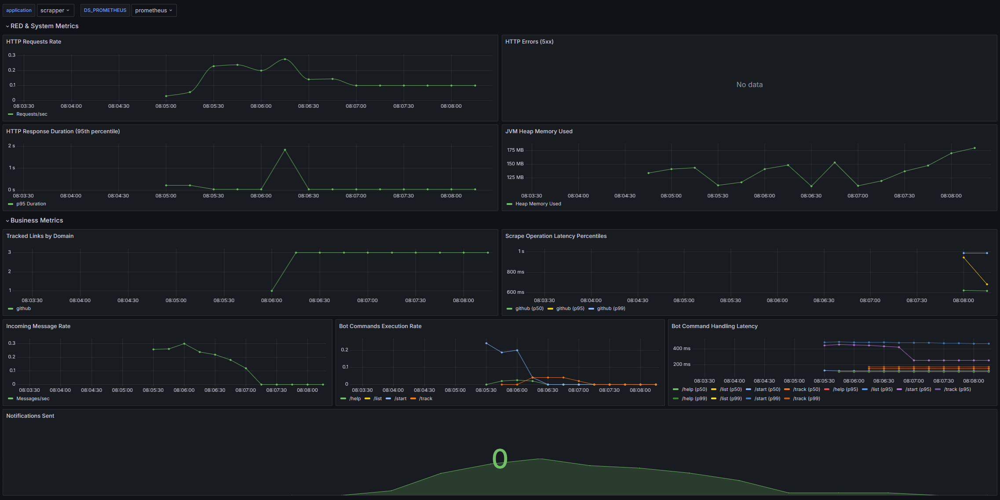
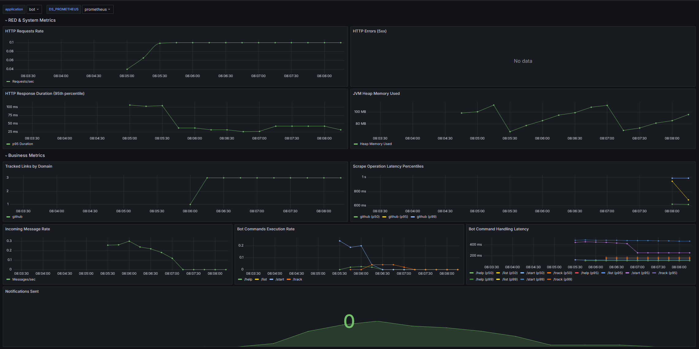
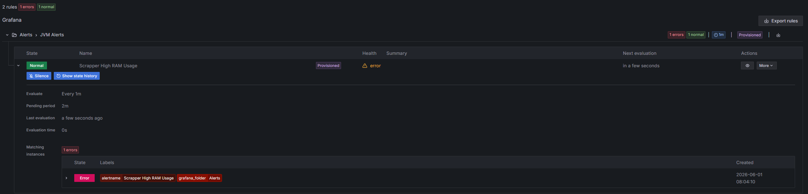

# Link Tracker — Distributed Event-Driven Notification System

Распределенная микросервисная система для мониторинга обновлений на **GitHub** (Issues, Pull Requests) и **StackOverflow** (ответы, комментарии) с интеллектуальной фильтрацией, LLM-суммаризацией и доставкой уведомлений в Telegram.

---

## 🏗 Модульная структура проекта

Проект построен по подходу **Contract-First** на базе Maven Multi-Module:

* **`scrapper`** — ядро мониторинга и управления подписками. Опрашивает внешние API в многопоточном пуле, хранит состояние ссылок и тегов в PostgreSQL, публикует сырые события об обновлениях.
* **`ai-agent`** — конвейер интеллектуальной обработки уведомлений. Вычитывает события из Kafka, выполняет фильтрацию (`FilterService`), приоритизацию (`PrioritizationService`), агрегацию и батч-группировку по расписанию (`GroupingService`), а также генерирует краткую сводку обновлений через LLM (`LlmContentSummarizer`).
* **`bot`** — Telegram-бот на базе конечного автомата состояний (FSM) для диалоговых сценариев (`/track`, `/untrack`, `/list`), валидации ссылок и доставки обработанных дайджестов.
* **`api-contracts`** — единый источник истины: OpenAPI-спецификации (`scrapper-api.yaml`, `bot-api.yaml`) и схемы **Apache Avro** (`link-update.avsc`) для кодогенерации контрактов.
* **`common`** — переиспользуемые инфраструктурные компоненты, включая фильтр ограничения трафика (`RateLimitingInterceptor`) и базовые конфигурации метрик.
* **`build-report-aggregate`** — агрегация отчетов тестового покрытия и статического анализа.

---

## ⚙️ Ключевые инженерные решения

* **Transactional Outbox & Kafka DLQ:** События об обновлениях атомарно сохраняются в таблицу `outbox` в PostgreSQL и асинхронно вычитываются планировщиком `OutboxScheduler` в кластер Kafka (Avro + Schema Registry). Это гарантирует доставку **At-least-once** при временной недоступности брокера. Сбойные сообщения маршрутизируются в Dead Letter Queue (DLQ).
* **Resilience & Graceful Degradation:** Интеграции с внешними API и LLM защищены паттернами **Resilience4j** (`Circuit Breaker`, `Retry`, `Timeout`). При недоступности LLM-провайдера `ResilientSummarizer` автоматически переключается на алгоритмический `SubstringSummarizer`, а на транспортном уровне поддерживается фоллбэк между Kafka и HTTP.
* **Переключаемый слой персистенции (JDBC / JPA):** Доступ к PostgreSQL реализован в двух параллельных вариантах — чистый SQL через JDBC (`*JdbcAdapter`) и ORM через Spring Data JPA (`*JpaAdapter`), переключаемых параметром `APP_DATABASE_ACCESS_TYPE`.
* **Двухуровневый кэш (L1 + L2) с Pub/Sub-инвалидацией:** Реализован кастомный `TwoLevelCacheManager`, объединяющий локальный in-memory кэш (`Caffeine`) и распределенный кластер `Valkey` с синхронной инвалидацией ключей между репликами через `CacheInvalidationListener`.
* **Качество кода и тестирование:** Настроены анализаторы **PMD** (`pmd.xml`), **SpotBugs** (`spotbugs-excludes.xml`), форматирование Palantir и CI-пайплайн (`.gitlab-ci.yml`). Покрытие включает unit-, интеграционные и сквозные E2E-тесты (`EndToEndHttpIT`, `EndToEndKafkaIT`, `OutboxIT`, `GitHubResilienceIT`) на базе **Testcontainers** и **WireMock**.

---

## 📊 Observability и мониторинг

Технические и бизнес-метрики собираются через Micrometer и Spring AOP (`ControllerMetricsAspect`, `RepositoryMetricsAspect`) в **Prometheus** и визуализируются в **Grafana** с настроенным алертингом по памяти (`monitoring/alerts/ram_alert.yml`).

📄 Детальное описание метрик, PromQL-запросов и алертов — в **[OBSERVABILITY.md](./OBSERVABILITY.md)**.

| Scrapper Dashboard | AI-Agent Dashboard |
| :---: | :---: |
|  |  |

| Telegram Bot Dashboard | Alerting (RAM Threshold) |
| :---: | :---: |
|  |  |

---

## 🚀 Быстрый запуск

Вся инфраструктура (PostgreSQL, Liquibase, кластер Kafka из 3 брокеров, Schema Registry, кластер Valkey, Prometheus, Grafana и микросервисы) запускается через Docker Compose.

### 1. Настройка окружения
Создайте файл `.env` в корневом каталоге проекта на основе шаблона `.env_dist`:
```bash
cp .env_dist .env
```

Заполните ключи внешних API в `.env`:

* **Telegram:** `TELEGRAM_BOT_TOKEN` — токен бота от [@BotFather](https://t.me/BotFather).

* **GitHub:** `GITHUB_TOKEN` — Personal Access Token для работы с GitHub API.

* **StackOverflow:** `STACKOVERFLOW_KEY` и `STACKOVERFLOW_ACCESS_KEY` — ключи доступа к API.

* **Database:** По умолчанию заданы стандартные параметры (`postgres/postgres`), достаточные для локального запуска.

### 2. Запуск кластера

```bash
docker compose up -d
```

При старте автоматически выполняются:

1. Инициализация PostgreSQL и применение миграций **Liquibase** (`migrations/master.xml`) для создания таблиц, индексов и Outbox-очереди.

2. Поднятие кластера Kafka (3 брокера, 3 партиции, `Replication Factor = 3`) и Schema Registry.

3. Сборка и запуск микросервисов `scrapper`, `ai-agent` и `bot`.

---

## ⚡ Отчет о нагрузочном тестировании (k6)

Для оптимизации чтения подписок (`GET /list`) в `scrapper` проведено сравнительное нагрузочное тестирование (`load-testing/script.js`) на базе из **100 000 ссылок** (`load-testing/seed.sql`). Полный отчет доступен в **[load-testing/result.md](load-testing/result.md)**.

* **Нагрузка:** 20 параллельных виртуальных пользователей (VUs).

* **Профиль трафика:** 99% операций чтения (`GET`), 1% операций записи (`POST` / `DELETE`).

* **Длительность:** 1 минута разгона (ramp-up) + 5 минут удержания нагрузки.


| Конфигурация | Запрос | RPS | Среднее время | p(50) | p(95) | HTTP 200 | Ошибки |
| --- | --- | --- | --- | --- | --- | --- | --- |
| **Без кэша (PostgreSQL)** | GET/POST | ~125 | 40.91 мс | 40.74 мс | 64.46 мс | 100% | 0 |
| **L2 кэш (Valkey Cluster)** | GET/POST | ~165 | 6.08 мс | 4.87 мс | 12.48 мс | 100% | 0 |
| **L1 + L2 (Caffeine + Valkey)** | GET/POST | **~169** | **4.40 мс** | **2.91 мс** | **11.82 мс** | 100% | 0 |

**Выводы:**

1. **Снижение нагрузки на БД:** Внедрение распределенного L2-кэша (Valkey) сняло нагрузку на чтение с PostgreSQL и сократило среднее время ответа более чем в **6.5 раз** (с `40.91 мс` до `6.08 мс`).

2. **Минимизация сетевых задержек:** Включение L1 Client-Side кэширования (`Caffeine`) снизило медианную задержку `p(50)` еще на **40%** (до `2.91 мс`).

3. **Консистентность:** При мутирующих запросах (`POST` / `DELETE`) кэш синхронно инвалидируется на обоих уровнях через Pub/Sub, исключая возврат устаревших данных.
